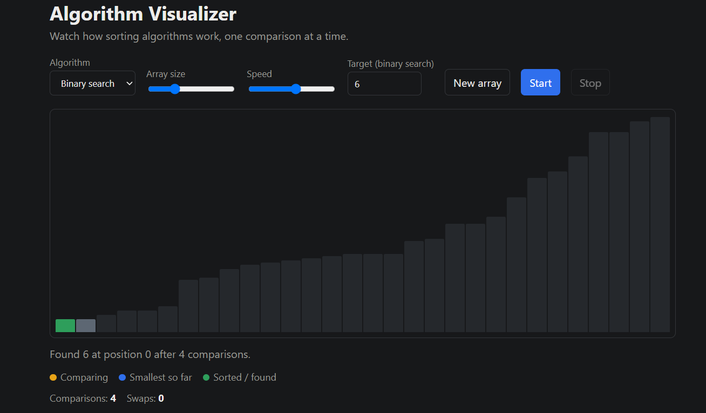

# Algorithm Visualizer

An interactive web app that animates sorting and searching algorithms step by step, so you can see how each one works.

**Live demo:** https://visual-sort-lab.netlify.app

## Demo



[Open the demo video](demo.gif.mp4)

## Features
- 5 sorting algorithms: selection, bubble, insertion, merge and quick sort
- Binary search with a custom or random target and a visible shrinking range
- Adjustable array size and animation speed, plus Stop and New array
- Live counters for comparisons and swaps
- Info panel showing best, average and worst time complexity and space complexity for the selected algorithm
- Dark and light mode support, responsive layout

## Tech used
HTML, CSS, JavaScript (no libraries)

## How it works
Every algorithm is written as an `async` function that calls `await step()` after each comparison or swap. This pauses the animation and also lets the Stop button end the run safely. Adding a new algorithm only needs a new function, one entry in the `algorithms` object and one dropdown option.

## Complexity
| Algorithm | Best | Average | Worst | Space |
|-----------|------|---------|-------|-------|
| Selection sort | O(n²) | O(n²) | O(n²) | O(1) |
| Bubble sort | O(n²) | O(n²) | O(n²) | O(1) |
| Insertion sort | O(n) | O(n²) | O(n²) | O(1) |
| Merge sort | O(n log n) | O(n log n) | O(n log n) | O(n) |
| Quick sort | O(n log n) | O(n log n) | O(n²) | O(log n) |
| Binary search | O(1) | O(log n) | O(log n) | O(1) |

## Run locally
```
git clone https://github.com/rs3971269-coder/Algorithm-Visualizer.git
```
Then open `index.html` in a browser. No install needed.

## What I learned
- Writing recursive algorithms (merge sort, quick sort) and animating them
- Using async/await to control timing in the browser
- Comparing time and space complexity in practice
- Structuring a JavaScript project across several files and deploying it on Netlify

## Future improvements
- Shortest path finder (BFS and Dijkstra) on a grid
- Heap sort